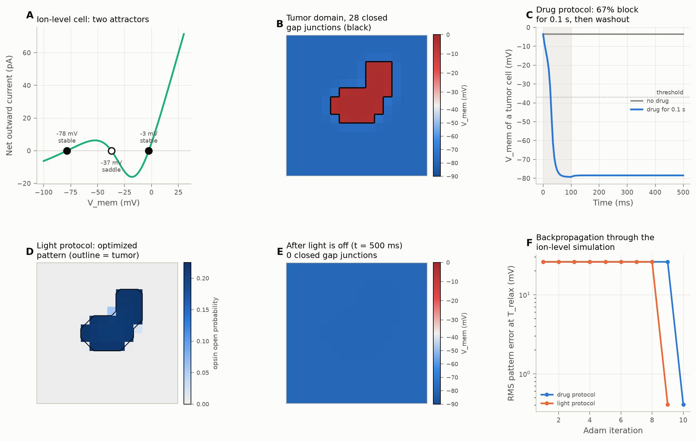

# bioelectrics

**A differentiable engine for somatic bioelectricity, in PyTorch.**

`bioelectrics` simulates the membrane potential (V_mem) of non-neural tissues at the
level of ions, channels, pumps and gap junctions, and computes exact gradients of any
outcome with respect to any parameter. It uses these gradients for the **bioelectric
inverse problem**: which experimentally realizable intervention (a channel mRNA, a
drug dose, a gap junction blocker, a light pattern), applied for a short time, moves a
tissue into a target V_mem pattern that then persists on its own?

The library builds on the work of Michael Levin's lab, Alexis Pietak (BETSE), and
Javier Cervera and Salvador Mafe. See [Related tools](#related-tools) for what it
takes from them and what it adds.



*(A) An ion-level cell (GHK fluxes, pumps, a K⁺ inward rectifier and a depolarizing cation
channel) has two attractors. (B) A depolarized "tumor" domain is isolated by closed
voltage-gated gap junctions. (C) An optimized bath drug, given for 0.1 s and then washed
out, flips the tumor cells into the healthy attractor. (D) An optimized light pattern for
an anion channelrhodopsin concentrates the light on the tumor. (E) The tissue after the
light is off. (F) Optimization by backpropagation through the simulation.*

Results of this demo (16×16 cells, 31 tumor cells):

| Protocol | Optimized intervention | RMS error at 0.5 s |
|---|---|---|
| Drug | block 67 % of the depolarizing channel in the bath for 0.1 s, then wash out | 26.1 → 0.41 mV (98.4 % lower) |
| Light | light on 32 cells (mean opsin open probability 0.22 on the tumor, 0.003 elsewhere) for 0.1 s | 26.1 → 0.41 mV (98.4 % lower) |

The full protocol tables are in [`assets/ionic_protocols.md`](assets/ionic_protocols.md).

## What you can do with it

| Task | API |
|---|---|
| Simulate V_mem, Na⁺/K⁺/Cl⁻/Ca²⁺ concentrations and channel gates in a tissue (grid or any graph) | `bioelectrics.ionic.IonicTissue` |
| Use BETSE-compatible physics: GHK electrodiffusion, Na/K- and Ca-ATPase, voltage-gated electrodiffusive gap junctions | `bioelectrics.ionic` |
| Express gated channels from a library (Kv1.5, Kir2.1, HCN2, Cav1.2, leaks, CAM-type channels) | `bioelectrics.ionic.LIBRARY` |
| Get gradients of any V_mem outcome with respect to channel expression, pump rates, gap junction density | `torch.autograd` through the solvers |
| Design interventions and print them as a lab protocol | `bioelectrics.interventions.InterventionOptimizer` |
| Run published models and their reproduction tests | `bioelectrics.zoo` |
| Use the fast voltage-level (CAM) model for large tissues | `bioelectrics.Tissue`, `PatternOptimizer` |

## Installation

```bash
git clone https://github.com/tlcdv/bioelectrics.git
cd bioelectrics
python -m venv .venv
.venv/bin/pip install -e ".[dev]"      # Windows: .venv\Scripts\pip
.venv/bin/python -m pytest             # about 3 minutes on a laptop CPU
```

Requires Python ≥ 3.10 and PyTorch ≥ 2.0. A GPU is not required.

## Quickstart: design a drug protocol

```python
import torch
from bioelectrics.ionic import IonicTissue, ChannelExpression, K_IR_CAM, CAT_DEP_CAM
from bioelectrics.interventions import ChannelBlocker, InterventionOptimizer

# Hardware: each cell expresses a K+ inward rectifier and a depolarizing cation channel.
tissue = IonicTissue(channels=[ChannelExpression(K_IR_CAM, 1e-16),
                               ChannelExpression(CAT_DEP_CAM, 1e-16)])

# Software: an 8x8 tissue at -78 mV with a 2x2 depolarized domain at -3 mV.
v0 = torch.full((1, 8, 8), -0.078, dtype=torch.float64)
v0[:, 3:5, 3:5] = -0.003
state = tissue.simulate(tissue.with_vmem(tissue.initial_state((8, 8)), v0), 0.5)

# Which dose of a bath-applied blocker of the depolarizing channel, given for 0.1 s and
# then washed out, puts every cell into the healthy attractor by t = 0.5 s?
opt = InterventionOptimizer(tissue, state, torch.full_like(v0, -0.078),
                            [ChannelBlocker("Cat_dep(CAM)", cost=1.0)], t_stim=0.1, t_relax=0.5)
print(opt.optimize(n_iters=30, tol_mV=1.0).protocol.to_markdown())
```

### Examples

| Script | What it shows | Output |
|---|---|---|
| [`examples/ionic_tumor_normalization.py`](examples/ionic_tumor_normalization.py) | Ion-level tissue: optimized drug dose and optimized optogenetic light pattern | `assets/ionic_tumor_normalization.png`, `assets/ionic_protocols.md` |
| [`examples/tumor_reprogramming_demo.py`](examples/tumor_reprogramming_demo.py) | Voltage-level (CAM-type) tissue: optimized current stimulus I_ext(t, x, y) | `assets/inverse_reprogramming_result.png` |

## Concepts

The API uses the terms of [`DOMAIN_CONCEPTS.md`](DOMAIN_CONCEPTS.md), after Levin &
Martyniuk (2018) and Levin (2019):

- **Hardware and software.** Channel and gap junction expression (`ChannelExpression`,
  `IonicTissue` parameters) is the hardware. The V_mem pattern (`IonicState`,
  `BioelectricState`) is the software, which stores pattern memory.
- **Target morphology as an attractor.** The optimizers are error-minimizing controllers
  that move a tissue from one basin of attraction into a target attractor.
- **Triggers, not clamps.** Every inverse design has an intervention phase `[0, T_stim]`
  and an intervention-free phase `[T_stim, T_relax]`. The error is measured at `T_relax`,
  so a solution must be a permanent attractor switch.
- **Computational boundary of the self.** A large transjunctional voltage closes gap
  junctions and isolates a depolarized domain; re-polarization re-opens them.

## Physics and validation

Equations, parameters and their sources are in [`MATH_REFERENCE.md`](MATH_REFERENCE.md).
All internal math is in SI units. The tests check the physics against analytic results
and published results:

| Test file | What it checks |
|---|---|
| `test_ionic_physics.py` | Nernst and GHK voltage limits, pump stoichiometry and sign, mass and charge conservation in gap junctions, BETSE gap junction gating formula, grid = graph, gradients |
| `zoo/test_cam2016.py` | Cervera et al. (2016): fixed points (−58.6, −15.5, −7.5 mV), Fig. 4 (normalization depends on coupling), Fig. 5 (channel over-expression blocks normalization) |
| `test_interventions.py` | The tumor is a stable attractor; an optimized drug dose normalizes it permanently; an optimized light pattern targets the tumor |
| `test_single_cell.py`, `test_tissue_domains.py`, `test_inverse_control.py` | Voltage-level model: bistability, domain walls, current-stimulus inverse control |

## Related tools

| Tool | What it is | Relation to this library |
|---|---|---|
| [BETSE](https://gitlab.com/betse/betse) (Pietak & Levin) | Full bioelectric tissue simulator: electrodiffusion, extracellular space, gene and metabolic networks, GUI (BETSEE) | The ion-level physics here is ported from BETSE (BSD-2-Clause, see [`THIRD_PARTY_NOTICES.md`](THIRD_PARTY_NOTICES.md)). BETSE is far more complete; this library adds gradients and inverse design, and has no extracellular space model yet. |
| [BioElectricNetwork](https://github.com/santamanicka/BioElectricNetwork) (Manicka & Levin 2019) | Minimal bioelectric networks trained with backpropagation and genetic algorithms (logic gates, pattern detection) | Pioneered gradient training of bioelectric networks. This library is a general, tested package with BETSE-level physics and lab-realizable interventions. BEN is not yet in the zoo (see below). |
| [ElectricMorphogenesis](https://github.com/santamanicka/ElectricMorphogenesis) (Manicka & Levin 2025) | Bioelectric field models of tissue-level voltage patterning, trained with backpropagation | Complementary: it models endogenous electric fields, which this library does not yet include. |
| Cervera, Alcaraz & Mafe models | Bistable cell model and multicellular patterns (Sci. Rep. 2016 and later) | Implemented in `bioelectrics.zoo.cam2016` with reproduction tests; CAM-type gating is also available at ion level. |

## Limitations and roadmap

Present limitations, stated so that results are not over-read:

- The extracellular space is a fixed bath (as BETSE without `is_ecm`). There are no
  extracellular electric fields or extracellular diffusion.
- The CAM-type channels used for bistability are phenomenological, not models of one
  specific protein. The BETSE Kir2.1 model alone does not give bistability with the
  default profile.
- Drug interventions are parameterized by blocked fraction, or by a user-supplied IC50
  and Hill coefficient. The library does not contain drug potency data.
- BPTT cost grows with simulated time; long rollouts on large ion-level grids are slow on
  a CPU (an 8×8 tissue: about 4 s per optimization iteration for a 0.5 s rollout).

Planned:

- BEN (Manicka & Levin 2019) in the zoo. The equations in its Fig. 8 have inconsistent
  units and signs, so an exact reproduction needs confirmation from the authors.
- Implicit differentiation through steady states (gradients of attractors without BPTT).
- Higher-order stiff solvers, GPU benchmarks, Voronoi cell meshes from segmented images.
- Gene regulatory network coupling (V_mem → expression → channels).
- Fitting model parameters to voltage-dye (DiBAC, CC2-DMPE) images.

## Contributing and citation

See [`CONTRIBUTING.md`](CONTRIBUTING.md). If you use the library, cite it with
[`CITATION.cff`](CITATION.cff), and cite the papers of the models you use.

## References

- Levin, M. & Martyniuk, C. J. (2018). The bioelectric code: An ancient computational
  medium for dynamic control of growth and form. *BioSystems* 164, 76–93.
- Levin, M. (2019). The computational boundary of a "self": Developmental bioelectricity
  drives multicellularity and scale-free cognition. *Frontiers in Psychology* 10, 2688.
- Pietak, A. & Levin, M. (2016). Exploring instructive physiological signaling with the
  bioelectric tissue simulation engine. *Frontiers in Bioengineering and Biotechnology* 4, 55.
- Cervera, J., Alcaraz, A. & Mafe, S. (2016). Bioelectrical signals and ion channels in the
  modeling of multicellular patterns and cancer biophysics. *Scientific Reports* 6, 20403.
- Manicka, S. & Levin, M. (2019). Modeling somatic computation with non-neural bioelectric
  networks. *Scientific Reports* 9, 18612.
- Verwer, J. G., Spee, E. J., Blom, J. G. & Hundsdorfer, W. (1999). A second-order
  Rosenbrock method applied to photochemical dispersion problems. *SIAM J. Sci. Comput.* 20,
  1456–1480.

## License

MIT. Parts of `src/bioelectrics/ionic/` are derived from BETSE (BSD-2-Clause); see
[`THIRD_PARTY_NOTICES.md`](THIRD_PARTY_NOTICES.md).
