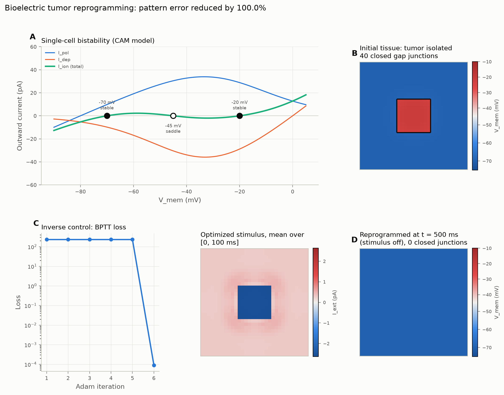

# bioelectrics

**Differentiable Somatic Bioelectricity Engine.** A PyTorch library that models
non-neural bioelectric networks: resting potential $V_{mem}$, voltage-gated ion
channels, and voltage-gated gap junctions. It solves the **Bioelectric Inverse
Problem** with automatic differentiation (backpropagation through time).

The model follows the work of Michael Levin, Alexis Pietak (BETSE), Javier Cervera,
and Salvador Mafe (the Cervera–Alcaraz–Mafe, or CAM, bistable cell model).



*(A) Bistable single-cell I–V curve. (B) A depolarized tumor domain isolated by closed
gap junctions (black lines). (C) BPTT loss and the optimized stimulus, averaged over
$[0, T_{stim}]$. (D) The tissue holds the healthy polarized attractor at $T_{relax}$,
after the stimulus has ended. All gap junctions are open again.*

## Concepts

Details are in [`DOMAIN_CONCEPTS.md`](DOMAIN_CONCEPTS.md).

- **Hardware vs. software.** The genome specifies the hardware: channel and gap
  junction expression (`ChannelProfile`, `GapJunctionProfile`). The $V_{mem}$
  distribution is the software (`BioelectricState`). The software stores pattern
  memory and can be rewritten without a change to DNA.
- **Target Morphology as an attractor.** A tissue stores a spatial $V_{mem}$ prepattern
  as a dynamical attractor. `PatternOptimizer` is an error-minimizing homeostatic
  controller. It moves the tissue from a corrupted basin of attraction into the target
  morphogenetic attractor.
- **Subroutine calls.** An intervention is a brief trigger. Every control simulation
  has an active phase $[0, T_{stim}]$ and a zero-stimulus phase $[T_{stim}, T_{relax}]$.
  The error is measured at $T_{relax}$, so success proves a permanent attractor switch,
  not a forced clamp.
- **Computational boundary of the self.** A depolarized tumor (about −15 mV) next to
  healthy tissue (about −70 mV) creates a high transjunctional voltage. This closes
  the gap junctions ($G_{ij} \to G_{min}$) and isolates the tumor. Re-polarization
  re-opens the junctions and normalizes the tissue.

## Equations

Details and BETSE source references are in [`MATH_REFERENCE.md`](MATH_REFERENCE.md).
All internal math is in SI units (V, A, s, F, S).

$$C_m \frac{dV_i}{dt} = -I_{pol}(V_i) - I_{dep}(V_i) - I_{leak}(V_i) + \sum_{j \in N(i)} G_{ij}(V_i - V_j) \cdot (V_j - V_i) + I_{ext, i}(t)$$

$$I_{pol}(V) = \frac{G_{pol}^0 (V - E_{pol})}{1 + \exp\left(\frac{z (V - V_{th, pol})}{V_T}\right)}, \qquad
I_{dep}(V) = \frac{G_{dep}^0 (V - E_{dep})}{1 + \exp\left(\frac{-z (V - V_{th, dep})}{V_T}\right)}$$

$$G_{ij}(V_{ij}) = G_{min} + \frac{G_{max} - G_{min}}{1 + \exp\left(\frac{\vert V_{ij}\vert - V_0}{V_{width}}\right)}$$

with $E_{pol} = -0.080\text{ V}$, $E_{dep} = 0\text{ V}$, and $V_T = RT/F \approx 0.0267\text{ V}$
at $T = 310.15\text{ K}$.

The default `ChannelProfile` gives two stable fixed points, −70 mV (polarized) and
−20 mV (depolarized), with a saddle at −45 mV.

## Installation

```bash
git clone https://github.com/tlcdv/bioelectrics.git
cd bioelectrics
python -m venv .venv
.venv/bin/pip install -e ".[dev]"
```

On Windows, use `.venv\Scripts\pip`. Requires Python ≥ 3.10 and PyTorch ≥ 2.0.

## Quickstart

```python
import torch
from bioelectrics import ChannelProfile, Tissue, find_fixed_points, tumor_prepattern
from bioelectrics.control import PatternOptimizer

# Hardware: default bistable channels and voltage-gated gap junctions.
tissue = Tissue()
v_healthy = find_fixed_points(ChannelProfile())[0][0]  # about -0.070 V

# Software: a 32x32 polarized tissue with a 10x10 depolarized tumor.
state, mask = tumor_prepattern(32, 32, patch=10, v_healthy_mV=-70.0, v_tumor_mV=-15.0)

# Forward simulation: the tumor persists behind closed gap junctions.
print(tissue.simulate(state, duration=1.0).v_mV[0][mask].mean())  # about -21 mV

# Inverse problem: find a 100 ms trigger that writes the healthy pattern.
opt = PatternOptimizer(tissue, state.v, torch.full_like(state.v, v_healthy),
                       t_stim=0.1, t_relax=0.5, lr=0.5)
result = opt.optimize(n_iters=30, tol=1e-5)
print(f"pattern error reduced by {100 * result.error_reduction:.1f}%")
```

Run the full demo (writes `assets/inverse_reprogramming_result.png`):

```bash
python examples/tumor_reprogramming_demo.py
```

## Package layout

| Module | Content |
|---|---|
| `constants.py` | SI constants, mV ↔ V converters |
| `channels.py` | `ChannelProfile`, $I_{pol}$, $I_{dep}$, $I_{leak}$, GHK current, fixed points |
| `gap_junctions.py` | Voltage-gated $G_{ij}$, grid and graph coupling |
| `tissue.py` | `BioelectricState`, `Tissue`, `tumor_prepattern` |
| `integrators.py` | Differentiable Euler and RK4 |
| `control.py` | `PatternOptimizer`, `OptimizationResult` |
| `viz.py` | I–V curves, $V_{mem}$ maps, loss and stimulus plots |

All ODE evaluations are vectorized over cells and batch dimensions
(`(batch, H, W)` or `(batch, N_cells)`). Every biophysical parameter can have
`requires_grad=True`.

## Tests

```bash
pytest --cov=bioelectrics
```

| Test file | What it verifies |
|---|---|
| `test_single_cell.py` | Bistability, permanent switching by a brief pulse, gradient flow |
| `test_tissue_domains.py` | Passive equalization, 32×32 domain wall isolation, ungated control |
| `test_inverse_control.py` | ≥ 85 % pattern error reduction, tumor erased and held without stimulus |
| `test_viz.py` | Figure generation |

## References

- Levin, M. & Martyniuk, C. J. (2018). The bioelectric code: An ancient computational
  medium for dynamic control of growth and form. *BioSystems* 164, 76–93.
- Levin, M. (2019). The computational boundary of a "self": Developmental
  bioelectricity drives multicellularity and scale-free cognition.
  *Frontiers in Psychology* 10, 2688.
- Cervera, J., Alcaraz, A. & Mafe, S. (2016). Bioelectrical signals and ion channels in
  the modeling of multicellular patterns and cancer biophysics. *Scientific Reports* 6, 20403.
- Pietak, A. & Levin, M. (2016). Exploring instructive physiological signaling with the
  bioelectric tissue simulation engine (BETSE). *Frontiers in Bioengineering and
  Biotechnology* 4, 55.
